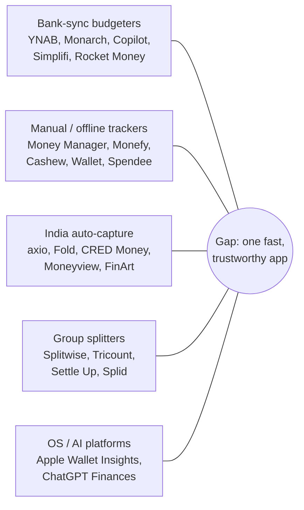

# Expense Tracker Market Research: Synthesis

Research date: **2026-10-05**. This document condenses six detailed reports in `docs/research/`. Every claim here is traceable to a cited source in those files.

| Report | Scope |
|---|---|
| [`research/global-budgeting.md`](research/global-budgeting.md) | YNAB, Monarch, Copilot, Rocket Money, Simplifi, Quicken, EveryDollar, PocketGuard, Empower, Mint→Credit Karma, Tiller, Lunch Money, Actual, Goodbudget, Origin |
| [`research/manual-trackers.md`](research/manual-trackers.md) | Money Manager (Realbyte), Spendee, Wallet, Money Lover, Monefy, 1Money, Toshl, Bluecoins, Fast Budget, MoneyWiz, Cashew, Ivy Wallet, Expense Manager, Spending Tracker, Daily Budget, Buddy, Emma, Fina, Pennies, Dollarbird, plus AI/voice newcomers |
| [`research/india.md`](research/india.md) | axio (Walnut), Fold, ET Money, Moneyview, INDmoney, Jupiter, Fi, CRED Money, Paytm/PhonePe/GPay, Kuvera, FinArt, Splitwise-in-India, indie newcomers; Account Aggregator, Play SMS policy, UPI, DPDP |
| [`research/shared.md`](research/shared.md) | Splitwise, Tricount, Settle Up, Splid, Spliit, Kittysplit, Honeydue, Zeta, Goodbudget/Monarch/YNAB households, Splitkaro, receipt itemizers |
| [`research/reviews.md`](research/reviews.md) | Cross-app review mining: about 12,000 store reviews (4,820 substantive 1–3★), Reddit, HN, Trustpilot; why users abandon apps, wishlist, retention stats |
| [`research/tech.md`](research/tech.md) | Bank aggregators, open-banking regulation, SMS/email/OCR/voice/LLM capture, local-first sync engines, frameworks, security and compliance, 2025–26 trends |

**Evidence limits.** Reddit and Trustpilot pages were blocked for direct reading, so quotes from those sites come from search snippets and are labelled that way in the reports. Theme percentages come from keyword tagging, which is indicative, not exact. Figures marked `[unverified]` in the source reports are not repeated here as facts.

---

## 1. Market map

The market splits into five segments. No product covers more than two of them well.

| Segment | Leaders (2026) | What they do well | Where they fail |
|---|---|---|---|
| **Bank-sync budgeters (US/EU)** | Monarch (Core $99.99/yr; Plus $199/yr), YNAB ($109/yr), Copilot ($95/yr, Apple + web only), Simplifi, Rocket Money | Auto-import, rules, review inbox, net worth, household seats | Sync breaks, price hikes, redesign churn, bot-only support, US-centric, **no Indian banks** |
| **Manual / offline trackers** | Money Manager (466K Play reviews), Wallet (387K), Money Lover, Monefy, 1Money, Cashew | Fast entry, no bank linking, one-time pricing, calendar and reports | Sync and backup data loss, ads, paywall creep, slow redesigns, missing ledger basics (splits, cleared flag, rollover) |
| **India auto-capture** | axio (ex-Walnut, owned by a lender), Fold (AA-based, SEBI RIA), CRED Money, Moneyview, FinArt | SMS/AA auto-capture, bill reminders, net worth | Missed or duplicate SMS captures, loan upsell, privacy fear, no cash, UPI misclassification, iOS gap, data loss on phone change |
| **Group splitters** | Splitwise (free tier capped at 3–5 expenses/day plus ads since Dec 2023), Tricount (bunq), Settle Up, Splid | Debt simplification, fast group entry, offline on trips | Paywalls, no personal budget (**835-vote request open since 2014**), no UPI settlement, double entry with personal tracker |
| **Platforms and AI** | Apple Wallet Insights (iOS 27, Sep 2026), ChatGPT Finances (May 2026, US Pro preview via Plaid) | Zero-setup insights, natural-language Q&A | Shallow budgeting, US/UK-centric, no cash, splits or India capture |

**Recent market events that shape the opportunity:**
- **Mint shut down on 23 Mar 2024** (about 3.6M MAU). Users got a short export window and lost budgets, so data portability is now a buying criterion.
- **Fi Money shut its banking app on 11 Mar 2026.** Walnut became axio under a lender, and Kuvera became "Kuvera by CRED". Indian users have watched trusted apps disappear or change owners.
- **Prices keep rising:** YNAB went from $45 to $109/yr, Monarch added a $199 tier, and Fold Plus launched at ₹2,999/yr with export moved behind the paywall.
- **Bank data costs are rising:** JPMorgan began charging aggregators in 2025, the US §1033 rule is enjoined and being rewritten, and the free EU GoCardless/Nordigen tier closed to new signups in Jul 2025.
- **Redesigns drove users away in 2025–26:** YNAB (about 63 of 101 recent ≤2★ reviews cite the UI), Spendee 6 ("wait between every tap"), Bluecoins v13, PocketGuard's Aug 2026 Insights rewrite.

---

## 2. Pain-point taxonomy (ranked)

The ranking combines frequency in store reviews, severity, explicit links to quitting, and how often a theme recurs across Reddit, HN, blogs and India sources. The IDs `PP-xx` are referenced from `PRODUCT_CONTEXT.md`.

### Tier 1: these cause churn

| ID | Pain point | Evidence (short) | Apps hit |
|---|---|---|---|
| **PP-01** | **Auto-capture is unreliable** (bank sync disconnects and re-auth loops, missed or duplicated SMS, wrong dates, debits imported as credits, gaps never backfilled) | 15.6% of 1–3★ reviews (5.7% strict); 23% of axio's low-star reviews are about broken SMS parsing; "Once that happens, you're gone for" (Copilot 1★) | Every sync app; axio, Fold, Wallet |
| **PP-02** | **Price vs value; hostile billing** (hikes, charged after cancel or trial, revoked lifetime licences, prices shown only after linking accounts) | Largest tag (31.8% broad / 7.7% strict); YNAB $45→$109; Rocket Money 60% of recent reviews ≤2★ | YNAB, Monarch, Rocket Money, PocketGuard, Copilot, Monefy, Spending Tracker, Bluecoins, Fold |
| **PP-03** | **Logging fatigue / "second job"** (too many taps, decisions, uncategorized backlog) | Irrational Labs RCT (n=9,035): 84% opened their budget ≤5 times in 13 weeks; "Who selects 5 dropdowns… to log a ₹50 chai?" | All manual apps; also review-queue apps |
| **PP-04** | **Numbers can't be trusted** (duplicates, transfers and card payments counted as spending, refunds not netted, rules that don't stick) | "it became impossible to budget due to multiple duplicate transactions" (Monarch 3★); card spend + bill payment double-counted (axio) | Monarch, Copilot, YNAB, Cashew, axio, Fold, Spendee |
| **PP-05** | **Sync, backup and data loss** (bring-your-own-cloud sync overwrites data, history lost on a new phone, restores fail) | Money Manager 12% and Bluecoins 13% of low-star reviews; Cashew issue #1218 duplicated ~19K rows; axio "lost all the categories" on a new phone | Monefy, Fast Budget, Bluecoins, Cashew, Spendee, MoneyWiz, axio, Tricount |
| **PP-06** | **Slow, laggy apps; redesigns that add taps** | 13.9% of reviews; "takes at least 30 seconds to load" (Monarch Android); "turtle slow" (Spendee); Monefy takes ~2 min to launch offline because of ads | YNAB, Monarch, Spendee, Bluecoins, Dollarbird, Pennies, CRED, Kuvera |

### Tier 2: these break trust or exclude whole segments

| ID | Pain point | Evidence (short) |
|---|---|---|
| **PP-07** | **Ads and upsells in the core loop** | Fast Budget shows a 5-second ad on every save; Monefy shows an ad on every open; ads persist after paying (Money Manager) |
| **PP-08** | **The tracker is a loan or credit funnel; privacy fear** | axio advertises loans at 14–35% p.a.; the top FinArt review (137 helpful) fears OTP exposure; 60% of 20 budgeting apps share data with third parties (Incogni) |
| **PP-09** | **Lock-in and app death** (no export, export paywalled, shutdowns) | Mint, Fi, 1Money, Ivy Wallet (archived), Vault; Fold paywalled export; Tricount removed export |
| **PP-10** | **Support is a bot or nothing** | 11.7% of reviews; "Of course the AI support bot was useless" (Monarch) |
| **PP-11** | **Method rigidity** (zero-based only, income assumed upfront, monthly-only periods) | 30% cite irregular income (Academy Bank survey); "I don't have all my money upfront" |
| **PP-12** | **Irregular expenses unsupported** (annual bills, sinking funds, rollover, accrual over months) | "add annual expenses that split over months" (PocketGuard); rollover missing (Cashew, Monefy, Money Manager) |
| **PP-13** | **Shared expenses entered twice** (splitter + tracker); "my share" vs "cash out" confusion | Splitwise request has 835 votes and has been "under review" since 2014; 6+ community YNAB/Monarch–Splitwise bridge scripts exist |
| **PP-14** | **Couples and family privacy and roles** (all-or-nothing visibility, no admin/view/edit roles, cross-platform sharing fails) | Monarch shows every account to household members; "provide admin, view or edit option" (Money Manager IN) |
| **PP-15** | **Cash is invisible** | "doesn't count cash spend as expenditure" (axio); Fold launched without manual entry; RBI says cash in circulation still grows at double digits |
| **PP-16** | **UPI-specific misclassification** (unreadable VPAs, P2P counted as spend, failed-then-refunded payments, payment source unclear) | `paytm@xytrq` → user renames it to "MyGrocer"; whether a UPI-on-credit-card payment came from the bank or the card is ambiguous |
| **PP-17** | **Multi-currency done naively** (history rewritten when rates change, no manual rate, card-settled amount not stored) | "if i change the rate… all the history will be updated" (Wallet); YNAB relies on a third-party plugin that breaks |
| **PP-18** | **Platform gaps** (no Android, no iOS SMS, weak web/iPad/desktop, mobile lacks desktop features) | Copilot has no Android; Monarch Plus is desktop-first; Money Manager has no multi-device sync |
| **PP-19** | **Missing ledger fundamentals** (split one transaction across categories, cleared/reconciled flag, credit card liability and due dates, EMI tracking, recurring income) | Cleared-flag request has 157 helpful votes (Spending Tracker); split transactions are missing in 6 apps |
| **PP-20** | **Recurring and subscription detection is wrong** (invents bills, misses real ones, can't model multiple subscriptions from one merchant) | "just makes up bills that don't exist" (PocketGuard); Simplifi shows one-off payments as recurring |

### Tier 3: quieter but differentiating

| ID | Pain point | Evidence (short) |
|---|---|---|
| **PP-21** | **Guilt and shame UX** (red screens, "feel broke") | Irrational Labs "information aversion"; r/ynab "Why does YNAB make me feel broke" |
| **PP-22** | **Onboarding overwhelm, clutter** | "I feel like I need an onboarding" (Monarch); "too many bells and whistles" (YNAB) |
| **PP-23** | **Reports that don't answer basic questions** (can't drill down, no trend lines, no custom date range, removed comparisons) | PocketGuard removed month-over-month comparison; Monarch removed tap-through to transactions |
| **PP-24** | **Accessibility** (colour-only states, VoiceOver gaps, layouts that don't scale) | YNAB colourblind complaint; an audit found VoiceOver could not reach YNAB Home controls |
| **PP-25** | **Auth friction** (frequent logouts, repeated MFA, no biometrics) | EveryDollar logs users out every 2 days; Simplifi requires "MFA 4 times" |
| **PP-26** | **Merchant/receipt-level splitting** (Amazon, Costco, itemized bills) | "Amazon Transactions are a nightmare" (r/ynab) |

---

## 3. What users love (must keep)

From 1,984 substantive 4–5★ reviews plus forums:

| Loved trait | Share / evidence | Exemplars |
|---|---|---|
| Simple, fast, intuitive | 23% of positive reviews | Spending Tracker, Monefy ("only the amount"), Daily Budget |
| Customization (categories, icons, themes) | 17% | Money Manager, Cashew |
| Recurring bills and reminders | 11%; the #1 adoption reason in India (FinArt) | Monarch auto-detect, CRED, axio |
| Clear insight and charts; calendar view | 8% | Money Manager calendar, Dollarbird calendar forecast |
| Review inbox + if-then rules applied retroactively | Monarch's most-cited feature | Monarch, Copilot |
| Safe-to-spend / leftover number | Recurring | Copilot "Free to Spend", PocketGuard "Leftover", Simplifi |
| Couples and household on one view without joint accounts | 7% | Monarch, YNAB Together, Settle Up weights |
| One-time or lifetime pricing; no ads | Repeated | Cashew $19.99 lifetime, Money Manager one-time, Kittysplit per-group fee |
| Local-first speed; "No data collected" label | Recurring | Actual ("responds instantly"), Cashew |
| No bank linking required (privacy, mindfulness) | Recurring | Money Manager, ProjectionLab |
| Receipt photos on transactions | Recurring | Money Manager, Monarch receipt import |
| Per-entry multi-currency with historical FX | Niche but loyal | Lunch Money, Toshl |
| Debt simplification, tap-the-payer-first entry, join by link without sign-up | Splitter favourites | Splitwise, Settle Up, Splid |

---

## 4. Wishlist (explicit user requests, ranked)

Ranked by mentions across 353 reviews that contain explicit wish phrasing, plus forum frequency.

1. Reliable capture (bank, SMS, UPI, email) **with fallback** when it fails (74 mentions).
2. Recurring and subscription management that's accurate, including recurring income (36).
3. Categorization that **learns from corrections** and asks only when unsure (29).
4. SMS/UPI auto-capture, including on iOS (28).
5. Better reports: trends, drill-down, custom ranges, cross-wallet (27).
6. Loans, lending and IOUs; reimbursements linked to the original expense (18).
7. Family and partner sharing with roles, cross-platform (18).
8. Web, desktop and iPad apps with full parity (16).
9. Widgets and quick entry, including lock screen and watch (15).
10. Tags and sub-categories (12); cash as a first-class account (12); fast search and filter (11).
11. Free export and backup (7); real multi-currency (5).
12. Others: annual-bill and sinking-fund planning; safe-to-spend until payday; split from a captured transaction; UPI settlement; cleared flag; EMI tracking; Indian financial-year and tax tags (80C/80D); UPI AutoPay mandate view; "stop changing the UI" or a classic-layout toggle; human support.

---

## 5. India-specific landscape facts

- **Nobody has replaced Walnut.** axio is rated 3.8★ and dominated by loan upsell and SMS-detection regressions. Since 2025 a wave of indie apps (Trakio, MonAI, UPI Tracker, Finzo, Xyra and others) pitch "on-device, no loans", but none has scale.
- **UPI:** a record 24.51B transactions in Aug 2026; a typical user makes 30–100 small UPI payments a week, so micro-transaction logging cost matters enormously. A 0.4% merchant fee (MDR) on P2M payments above ₹2,000 starts 15 Oct 2026.
- **Account Aggregator (AA):** 500M+ consents and 1,100+ entities live. Only RBI/SEBI/IRDAI/PFRDA-regulated entities can be data users (FIUs); Fold qualifies as a SEBI RIA. Credit cards are **not** on AA, and EPF/PPF are only "proposed". There is no public rate card. Bank quirks include HDFC data ~12h late, no ICICI data on weekends, and SBI linking working best 5–8 AM.
- **Play SMS policy:** "SMS-based money management" is an allowed exception that requires a declaration and approval. An Apr 2025 clarification forbids exfiltrating non-financial SMS or selling SMS data.
- **iOS cannot read SMS.** The workarounds are Shortcuts automations, email parsing, statement import and AA.
- **SMS is eroding:** banks have asked RBI to drop SMS alerts for transactions under ₹100. Since May 2025 sender IDs carry `-T/-S/-P/-G` suffixes, and the switch from `-S` to `-T` broke axio for at least one bank.
- **DPDP Act and Rules 2025:** most obligations apply from about **13 May 2027**. They include 72-hour breach reporting, per-purpose consent, easy withdrawal, notices in English plus Eighth Schedule languages, and penalties up to ₹250 crore.
- **Cash still matters:** RBI reports currency in circulation still growing at double digits.
- **Formatting:** lakh/crore grouping (₹12,34,567), compact ₹1.2L / ₹3.4Cr, Indian financial year (Apr–Mar).

---

## 6. Technology landscape facts (decision inputs)

- **Bank aggregation is costly and fragile.** Monarch runs 3 aggregators with per-bank switching and a public health dashboard. SimpleFIN (US/CA) costs the user $15/yr. Enable Banking is now the indie route in the EU (its free tier covers only accounts you link yourself). Apple FinanceKit covers Apple Card, Apple Cash and Apple Savings on-device.
- **Email:** Gmail read scopes are restricted and need an annual CASA assessment (about $540–675/yr). A **forward-to-app address** avoids that and is already used by Monarch and Fold.
- **Receipt OCR:** iOS 26 Vision `RecognizeDocumentsRequest` works on-device. Cloud OCR (Veryfi, Mindee) is an optional premium.
- **Voice:** iOS `SpeechAnalyzer` runs on-device. Android ML Kit speech has a basic mode on most API 31+ devices.
- **Categorization:** fine-tuned small models beat zero-shot GPT-4o (73.4% vs 60.4% in one study). Consumer apps reach about 90% first-pass accuracy with per-user learning. A cloud nano-LLM costs about $0.014 per 1,000 transactions (estimate). Gemini Nano works only on a few flagship phones and only in the foreground, so it can be an enhancement, never a dependency.
- **Responsiveness architecture:** local SQLite as the source of truth, with sync messages stamped by a hybrid logical clock (HLC) plus optional E2EE (Actual Budget's proven model). Vendor risk: Electric Cloud is winding down, Replicache is archived, Triplit's stewardship is uncertain; PowerSync is the mature hosted option.
- **OS quick-entry surfaces** (widgets, Control Center, Action button, Live Activities, Android Quick Settings tile, Wear) need native Swift/Kotlin code whatever cross-platform framework we choose.
- **Compliance:**
  - App Store: finance apps must be published by a company, not an individual (5.1.1(ix)).
  - Play: financial-features declaration for every app.
  - SOC 2: $25–80k and 6–14 months, needed only when partners require it.
  - Encrypted storage: SQLCipher, about 5–15% overhead.

---

## 7. Retention reality

- Finance-app day-30 retention is **4.2%** (Business of Apps) to **5.8%** (Statista via Sendbird). The all-app benchmark is D1 26% / D7 13% / D14 10% (Adjust).
- Engagement with budget features decays even when friction is low (Irrational Labs RCT). Real-time budget information can even *increase* spending near the end of a period (Ghosh & Huang).
- Plaid itself says mandatory periodic re-authentication "ultimately leads to consumer attrition".
- **Implication:** the product must deliver value with **near-zero ongoing effort** (passive capture plus a short weekly review). It must not depend on users opening the app daily out of discipline.

---

## 8. Strategic conclusions

1. **The wedge is trust plus speed, not more features.** The top churn drivers (PP-01 to PP-06) are reliability, honesty and responsiveness failures, not missing features.
2. **Layer capture so there is no single point of failure.** Combine manual entry, OS quick-entry surfaces, SMS/notifications, email forwarding, statements, receipts and optional bank or AA sync. One deduplication engine reconciles them, and every auto-captured item is reviewable.
3. **Build one ledger with correct semantics:** transfers, card liabilities, refunds, reimbursements, splits and cash modelled properly. This fixes PP-04, PP-13, PP-15, PP-16 and PP-19 together.
4. **Local-first:** instant UI, offline use, no data loss, free export. This answers PP-05, PP-06 and PP-09.
5. **Fair business model:** no ads, no lending, no data sale, honest pricing with a lifetime option, and export always free. This answers PP-02, PP-07, PP-08 and PP-09.
6. **India-first capture depth with global-ready foundations.** No global leader supports Indian banks, and no Indian app has replaced Walnut. Multi-currency and locale correctness keep the door open globally.
