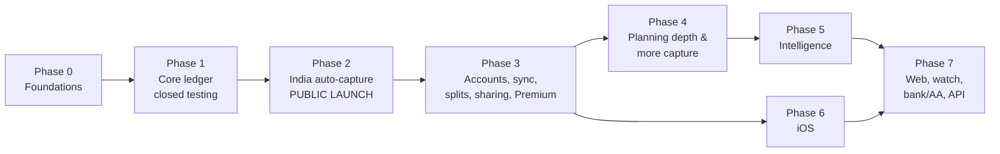

# Delivery Roadmap (Android first, then iOS)

Source of requirements: [`PRODUCT_CONTEXT.md`](PRODUCT_CONTEXT.md). Decisions D1–D10 (§10) are accepted. Platform order is in §6.5.
Every `FR-*` requirement is assigned to exactly one phase; see the coverage table in §3. A requirement with split priority (e.g. "M (CSV) / S (PDF)") is listed in the phase where it **completes**, and earlier partial delivery is noted inline.

## 1. Sequencing logic

1. **Get the data model right before features.** The ledger rules (§4) and the sync op-log schema ship in Phase 0. Splits, sync and dedup then build on a stable core without migrations of user data.
2. **Speed is a feature, so measure it from day one.** A performance harness with a 100k-transaction dataset runs in CI from Phase 0, and every phase exit requires the §6.1 budgets.
3. **The manual loop must be excellent before auto-capture.** Auto-capture without correct transfers, card handling and dedup reproduces the #1 and #4 complaints (PP-01, PP-04). Phase 1 delivers a trustworthy manual ledger. Phase 2 adds SMS capture on top of it.
4. **Public launch comes with the differentiator.** The public Play Store launch happens at the end of Phase 2 (SMS auto-capture, India). Phase 1 ships to closed testing only.
5. **Server-side personal data arrives in Phase 3** (accounts, sync, sharing). DPDP obligations (deadline ~13 May 2027) are scheduled there and must be complete before that date regardless of phase progress.
6. **Monetization starts only when there is something worth paying for:** sync, household sharing and server-backed capture (Phase 3+). Free tier rules (§7) apply from the first release.

Phase 6 (iOS) depends only on Phase 3, so it can run in parallel with Phases 4–5 if team capacity allows. Durations are not given because team size isn't fixed yet. Exit criteria, not dates, gate each phase.

---

## 2. Phases

### Phase 0: Foundations (no user release)

**Goal:** a project skeleton where the correct ledger, encrypted storage and the performance budget are proven before any feature work.

| Workstream | Deliverables |
|---|---|
| Project | KMP mono-repo with shared core modules (`domain`, `ledger`, `storage`, `sync-model`, `parsers`), `androidApp` (Jetpack Compose), `backend` (Ktor, Docker) skeleton; CI (build, unit and property tests, lint). **The shared modules also compile for the iOS target and run tests on the iOS simulator in CI.** Simulator builds don't need an Apple developer account, so iOS can follow later without rework. |
| Domain core | Money type (minor units, currency), ledger engine implementing §4: accounts, transfers, card liability, refunds/reimbursements, cash wallet, category splits, person ledger, multi-currency fields with rate-at-entry. Property-based tests for invariants: transfers net to zero; refunds net against their original; balances recompute identically. |
| Storage | SQLDelight + SQLCipher on Android. Key stored in the Android Keystore. Schema includes an **op-log with hybrid logical clock (HLC) timestamps from day one**, so sync (Phase 3) needs no data migration. Indexed for search and reports. |
| Performance harness | Synthetic dataset generator (100k transactions / 10 years / 500 categories and tags). Macrobenchmark + Baseline Profiles on the reference mid-range device. CI gate on cold start, list scroll jank, save latency, search and report queries (§6.1). |
| Design system | Compose components, light/dark themes, density setting, colour-blind-safe palette, TalkBack and font-scaling baseline (§6.4), lakh/crore formatter (FR-SET-01 groundwork) |
| Privacy baseline | No third-party ad or tracking SDKs (dependency allowlist in CI); opt-in privacy-preserving crash reporting |
| Admin / compliance | Company entity; Play developer account registered to the company; finalize the minimum Android version (proposed API 26) from Play distribution data for India; draft privacy policy. **Start the company Apple developer account (D-U-N-S number) in parallel** so it is ready by Phase 6. |
| Spikes | (a) iOS SQLCipher driver for SQLDelight (validates D2). (b) SMS parser prototype to size the parser work (done: see PHASE0_PROGRESS.md; about 200-300 message variants for 25 issuers, rules as data, review inbox for anything uncertain). (c) Compose list performance with 100k rows. (d) Compose Multiplatform iOS cold start on the simulator, plus a device check once the Apple account exists. Fallback if it misses ≤ 0.6 s: SwiftUI screens over the shared core in Phase 6. |

**Exit criteria:**
- Ledger property tests green.
- Empty-shell app on the reference device meets cold start ≤ 1.0 s and save ≤ 50 ms against the 100k dataset.
- Spike outcomes recorded. If a spike fails, update §10 decisions before starting Phase 1.

---

### Phase 1: Core ledger (Play closed testing)

**Goal:** the fastest, most correct manual tracker on Android. It must stand on its own for privacy-conscious manual users (persona P5), and it's the base everything else plugs into.

| Area | Requirements |
|---|---|
| Capture | FR-CAP-01 2-second entry · FR-CAP-03 templates/favourites · FR-CAP-02 **Android part**: Glance widget with quick-add and templates, Quick Settings tile, app shortcuts · FR-CAP-09 **CSV/XLS part** (statement import with column mapping and saved profiles) · FR-CAP-10 **attach part** (photo/file on a transaction) |
| Ledger | FR-LED-01 (all §4 semantics except group splits, which come in Phase 3) · FR-LED-06 category splits · FR-LED-07 payment-source attribution (manual) · FR-LED-08 undo and edit history · FR-LED-09 bulk edit |
| Categories | FR-CAT-05 custom hierarchy · FR-CAT-06 tags |
| Budgets | FR-BUD-01 **modes (a) overall cap and (b) category** · FR-BUD-02 flexible periods (salary-cycle start, weekly, Indian FY) · FR-BUD-04 budgets across accounts · FR-BUD-05 safe-to-spend |
| Recurring | FR-REC-01 recurring expense/income/transfer · FR-REC-03 bill and card due-date reminders |
| Reports | FR-RPT-01 home · FR-RPT-02 reports with drill-down · FR-RPT-03 calendar · FR-RPT-04 instant search |
| Data | FR-DATA-01 local-first · FR-DATA-04 free export CSV/XLSX/JSON + scheduled export to the user's Drive · FR-DATA-05 local backup/restore with integrity check |
| Security | FR-SEC-01 encrypted DB · FR-SEC-02 biometric/PIN app lock · FR-SEC-04 no tracking SDKs · FR-SEC-05 hide-balances mode |
| Notifications | FR-NOT-02 per-type settings and quiet hours (bill and recurring reminders use it) |
| Settings | FR-SET-01 INR lakh/crore and multi-currency formatting · FR-SET-03 themes and density · FR-SET-05 onboarding to first expense in < 60 s |

**Exit criteria:**
- All §6.1 Android budgets met on the 100k dataset.
- Ledger correctness test corpus green: transfers, card bill payment, refund, ATM → cash, split.
- Closed-testing cohort (target 50–100 users) shows median time to first expense < 60 s.
- Zero data-loss incidents; export → re-import round-trip is lossless.

---

### Phase 2: India auto-capture (public Play launch)

**Goal:** the Walnut replacement. SMS and notification capture that is private, reviewable and doesn't produce duplicates. This is the public launch.

| Area | Requirements |
|---|---|
| Capture | FR-CAP-05 SMS capture: on-device parsing, sender allowlist matched on the TRAI header root, OTP and personal SMS ignored; **Play SMS Permissions Declaration submitted early in the phase** · FR-CAP-06 notification capture (opt-in) · FR-CAP-12 review inbox with confidence and per-source auto-confirm · FR-CAP-13 capture health, "SMS not detected" report, over-the-air parser rules |
| Correctness | FR-LED-02 dedup engine and possible-duplicates queue · FR-LED-03 auto-pairing (card bill, failed UPI + refund, ATM, own-account transfers) · FR-LED-04 edits survive re-import |
| Categorization | FR-CAT-01 **layers 1–3**: user rules, learned merchant map, shared merchant/VPA dictionary · FR-CAT-02 corrections stick · FR-CAT-03 rules engine with test-against-history · FR-CAT-04 UPI VPA → merchant, P2P vs P2M |
| Engagement | FR-NOT-01 actionable notifications (categorize or split from the notification, bill due, weekly recap) · FR-RPT-06 weekly recap |
| Trust | FR-SEC-03 privacy dashboard (on-device part: permissions, what leaves the device) · FR-SEC-06 permission rationale screens · FR-SUP-01 in-app support with human escalation · FR-SUP-02 public parser-health status page |

**Parser coverage target at launch:** top 25 Indian banks and card issuers plus major UPI apps (§6.2). Build a labelled SMS corpus collected with consent from closed testers.

**Exit criteria:**
- SMS parser coverage ≥ 98% on the labelled corpus.
- Dedup precision ≥ 99%.
- SMS → inbox ≤ 2 s.
- No measurable battery drain.
- Play SMS declaration approved.
- ≥ 85% of transactions auto-captured for SMS-enabled testers.
- ≤ 5 manual corrections per 100 auto-captured transactions after 30 days.

**Risk:** the Play SMS declaration could be rejected. Mitigation: notification capture (FR-CAP-06) plus statement import already cover capture, and the declaration rationale relies on budgeting being the app's core function (Play policy, `research/india.md`).

---

### Phase 3: Accounts, sync, splits, sharing, Premium

**Goal:** multi-device continuity, the integrated split ledger (enter once, see your share, settle via UPI), households with privacy scopes, and the first paid tier.

| Area | Requirements |
|---|---|
| Backend | Docker deployment in an India region: accounts, HLC op-log sync relay, entitlements, Postgres (D3, D10) |
| Sync & continuity | FR-DATA-02 conflict-free multi-device sync with visible status · FR-DATA-06 new-device restore with no SMS re-parse duplicates |
| Splits | FR-SPL-01 split any transaction with people · FR-SPL-02 groups, weights, debt simplification · FR-SPL-03 non-app participants plus read-only web link (small hosted page) · FR-SPL-04 UPI deep-link/QR settlement, auto-matched to a captured UPI payment · FR-SPL-05 no caps, no ads · FR-SPL-07 offline group entry · FR-SPL-08 audit trail and settled/open marker · FR-SPL-09 recurring group bills · FR-REC-06 IOUs and personal loans |
| Household | FR-SHR-01 privacy scopes (Personal / Shared / Group) · FR-SHR-02 roles and invite by link (Android ↔ Android; iOS arrives in Phase 6) · FR-SHR-04 per-member views |
| Business | Premium via Play Billing: subscription **and** lifetime. Entitlements restorable from the account. Honest-billing rules (§7): price shown up front, trial reminder 48 h before charging, in-app cancel. |
| Compliance (DPDP) | Server-side half of FR-SEC-03: per-purpose consent records, in-app consent withdrawal and account deletion, grievance officer and 90-day SLA, 72-h breach runbook, 1-year log retention, India data residency. **Must be complete before ~13 May 2027.** |

**Exit criteria:**
- Sync p95 ≤ 5 s; zero conflicts lost in a fuzz test of concurrent offline edits.
- Split semantics test corpus green: paid-by vs consumed-by, friend-paid-for-me, settlement as transfer.
- DPDP checklist signed off.
- Billing flows pass Play policy review.

---

### Phase 4: Planning depth and more capture sources

**Goal:** close the remaining ranked pain points: irregular expenses, subscriptions, EMIs, multi-currency, migration, data guarantees and languages.

| Area | Requirements |
|---|---|
| Budgets | FR-BUD-01 **mode (c)** envelope/zero-based (completes) · FR-BUD-03 rollover · FR-BUD-06 sinking funds and spread purchases · FR-BUD-07 goals · FR-BUD-08 pace alerts |
| Recurring & debts | FR-REC-02 recurring detection (suggestions only) · FR-REC-04 subscription radar + UPI AutoPay mandate view · FR-REC-05 EMI and loan tracking |
| Ledger | FR-LED-05 cleared/reconciled flag and reconciliation flow |
| Capture | FR-CAP-08 email forwarding ingest (card alerts, statements, e-receipts) · FR-CAP-09 **password-protected PDF statements** (completes) · FR-CAP-10 **on-device receipt OCR** with line items (completes) · FR-CAP-14 migration importers (Money Manager, Monefy, Wallet, Spendee, Cashew, axio, Splitwise, YNAB, Mint/Monarch) |
| Multi-currency | FR-SPL-06 multi-currency trips with the card-settled amount |
| Reports | FR-RPT-05 net worth · FR-RPT-08 PDF reports and trip summaries |
| Data & trust | FR-DATA-03 opt-in end-to-end encryption for sync · FR-DATA-07 shutdown guarantee (published commitment + offline-capable build) · FR-SET-04 classic-layout toggle and in-app changelog |
| Languages | FR-SET-02 Hindi + top Indian languages (completes). The DPDP-notice language obligation needs this before ~May 2027; if Phase 4 would land later, pull the consent and notice translations into Phase 3. |

**Exit criteria:**
- Recurring-detection precision ≥ 95% on the test corpus (no invented bills, PP-20).
- Every importer round-trips each source app's sample export.
- E2EE mode: the server stores only ciphertext (verified by test).

---

### Phase 5: Intelligence

**Goal:** fewer taps and better answers, with AI that stays private.

| Area | Requirements |
|---|---|
| Entry | FR-CAP-04 natural-language and voice entry (on-device speech, confirmation chip) |
| Categorization | FR-CAT-01 **layers 4–5**: on-device model where available, opt-in cloud nano-model on de-identified strings (D9) (completes) · FR-CAT-07 micro-payment roll-ups |
| AI | FR-AI-01 "Ask your money" with the filter it used shown · FR-AI-02 privacy-first execution rules · FR-AI-03 insight nudges (unusual charges, price hikes, forgotten trials) |
| Planning | FR-BUD-09 30–90-day cash-flow forecast |
| India | FR-RPT-07 FY tax helpers (80C/80D/HRA, rent receipts) |

**Exit criteria:**
- Q&A answers match an SQL ground-truth suite (≥ 95%).
- No cloud call is made without opt-in (verified by network test).
- Categorization accuracy improves measurably over Phase 2 baseline.

---

### Phase 6: iOS (can start after Phase 3)

**Goal:** feature parity on iPhone using the shared KMP core and Compose Multiplatform UI, with native iOS surfaces.

| Area | Requirements |
|---|---|
| App | Compose Multiplatform iOS app on the shared core; SQLCipher via the driver validated in the Phase 0 spike; Keychain + Face ID lock; iOS §6.1 budgets (cold start ≤ 0.6 s) |
| Capture | FR-CAP-02 **iOS part**: WidgetKit, Lock Screen / Control Center / Action button controls, Siri/App Intents, Shortcuts (Android part shipped in Phase 1) · FR-CAP-07 iOS SMS bridge via Shortcuts automation → App Intent, with setup wizard and health check |
| Sharing | FR-SHR-02 cross-platform households (iOS ↔ Android) become complete |
| Store | App Store account registered to the company (§6.3); App Privacy labels |

FR-CAP-02's watch entry is **C** and moves to Phase 7.

**Exit criteria:**
- iOS budgets met.
- Every Phase 1–3 feature works on iOS (cross-platform parity suite green), except SMS reading, which iOS doesn't allow.

---

### Phase 7: Later (C priority, demand-driven)

| Requirement | Note |
|---|---|
| Web app (D8) | Bulk editing, reports, desktop; reuses the shared core |
| FR-CAP-02 watch entry | Wear OS tile, watchOS (completes FR-CAP-02) |
| FR-CAP-11 bank / AA sync | India AA only after the regulatory path is chosen (D5); SimpleFIN/Plaid/Enable Banking if the app goes global; FinanceKit on iOS |
| FR-AI-04 bring-your-own-AI (MCP) | Local or E2EE-safe |
| FR-DATA-08 public API / webhooks | Power users |
| FR-SHR-03 comments and reactions | Shared transactions |
| FR-SUP-03 public feature-request board | — |

---

## 3. Coverage table (every FR → phase)

| Phase | Requirements |
|---|---|
| 1 | CAP-01, CAP-03 · LED-01, LED-06, LED-07, LED-08, LED-09 · CAT-05, CAT-06 · BUD-02, BUD-04, BUD-05 · REC-01, REC-03 · RPT-01, RPT-02, RPT-03, RPT-04 · DATA-01, DATA-04, DATA-05 · SEC-01, SEC-02, SEC-04, SEC-05 · NOT-02 · SET-01, SET-03, SET-05 |
| 2 | CAP-05, CAP-06, CAP-12, CAP-13 · LED-02, LED-03, LED-04 · CAT-02, CAT-03, CAT-04 · RPT-06 · NOT-01 · SEC-06 · SUP-01, SUP-02 |
| 3 | DATA-02, DATA-06 · SPL-01, SPL-02, SPL-03, SPL-04, SPL-05, SPL-07, SPL-08, SPL-09 · REC-06 · SHR-01, SHR-04 · SEC-03 |
| 4 | BUD-01, BUD-03, BUD-06, BUD-07, BUD-08 · REC-02, REC-04, REC-05 · LED-05 · CAP-08, CAP-09, CAP-10, CAP-14 · SPL-06 · RPT-05, RPT-08 · DATA-03, DATA-07 · SET-02, SET-04 |
| 5 | CAP-04 · CAT-01, CAT-07 · AI-01, AI-02, AI-03 · BUD-09 · RPT-07 |
| 6 | CAP-07 · SHR-02 |
| 7 | CAP-02, CAP-11 · AI-04 · DATA-08 · SHR-03 · SUP-03 |

Partial deliveries before the completing phase:

| Requirement | Earlier part(s) | Completes in |
|---|---|---|
| CAP-02 | Android quick entry: Phase 1. iOS surfaces: Phase 6. | Watch, Phase 7 |
| CAP-09 | CSV/XLS: Phase 1 | PDF, Phase 4 |
| CAP-10 | Attachments: Phase 1 | OCR, Phase 4 |
| CAT-01 | Layers 1–3: Phase 2 | Phase 5 |
| BUD-01 | Modes (a) and (b): Phase 1 | Mode (c), Phase 4 |
| SEC-03 | On-device part: Phase 2 | Server/DPDP part, Phase 3 |
| SHR-02 | Android ↔ Android: Phase 3 | Cross-platform, Phase 6 |
| SET-02 | English: Phase 1 | Indian languages, Phase 4 |

## 4. Cross-phase guardrails

- **Performance:** §6.1 budgets are CI gates in every phase. Any regression blocks the release.
- **Correctness:** the ledger, dedup, split and recurring test corpora grow with each phase and are never relaxed.
- **UI stability:** after the public launch (Phase 2), any major layout change ships behind the classic-layout toggle once it exists (Phase 4). Until then, no redesigns of shipped screens.
- **Business rules (§7) from the first release:** no ads, no lending, no data sale; export always free.
- **DPDP deadline (~13 May 2027)** is a hard date. It overrides phase order for consent, notice, erasure and breach-process work.
